# One Request — a trip-planning agent by team "ekvivalentno"

**Built for the Ostrovok! Hackathon 2026, track «О!дин запрос» ("One Request"), October 2026.**

One message becomes a bookable trip: the agent asks only what it really needs, suggests destinations, picks stays and transport from live data, explains every choice and takes you to a simulated checkout. When you change a condition, the plan is rebuilt rather than searched from scratch. And the trips you have taken can be **poured into a new one**: their tastes blend into the concept of the next trip.

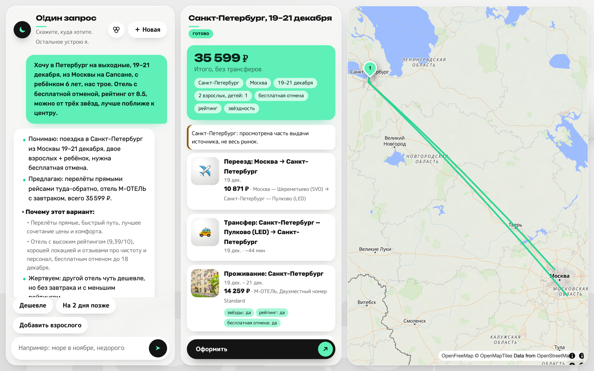

## Team

- **Ivan Safonov** — architecture of the multi-agent system and the agents' roles, the trip plan as a typed graph, the chat and the Telegram bot, the map, trip history and blending past trips into a new one, the front end
- **Semyon Davshits** — the agents' runtime: the orchestrator, the GigaChat and Tutu integrations, plan checks, the cart and payment, deployment and submission

> Originally built in Russian in the team's private hackathon repository.
> This repository is an English translation, republished with the teammates' permission.
> The product itself speaks Russian — it was built for a Russian travel platform — so the
> interface, the bot, the LLM prompts and the test requests stay in Russian; the code,
> the comments and the documentation are in English.

- Screencast of the submission (in Russian): https://disk.yandex.ru/d/v8oDlzgzn0SMeA

## The main idea: a plan is a structure, not a text

Several agents work on every message, but none of them writes the plan. A trip is a typed graph: stays and legs with stable ids, the offers chosen for them, conditions that remember where they came from ("you said", "from your trip to Kazan", "a default") and a version for every change. The LLM only understands language and words the answer; everything that touches money, dates or the choice of an offer is computed by code, through a closed set of operations with permissions per agent.

That one decision is what makes the rest possible:

- **Re-planning without starting over.** "Two days later" marks only the affected nodes stale; nothing else is searched again, and the answer shows exactly what changed and by how much.
- **Checks you can trust.** Seventeen connection rules (arrival versus check-in, transfers, night arrivals, room capacity, budget, cancellation deadlines) run on the graph, not on prose.
- **No invented numbers.** Every sum, date and hotel name in the answer is checked against the facts the code produced; a mismatch means one retry and then a template.
- **Trips that inherit from each other.** Because tastes are the same typed conditions, they can be lifted out of a past trip, merged, carried into a new one and taken out again — the feature below.

## Blending past trips into a new one

The track asked for a system that remembers your past trips. We made that memory something you can see and hold: past trips sit on a shelf as coloured drops, and you pour them into a bowl. The concept absorbs them like liquid, its colour turns into a mix of the trips inside, and their tastes appear below as ingredients of the new trip.

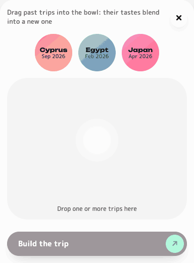

<table>
<tr>
<td width="50%">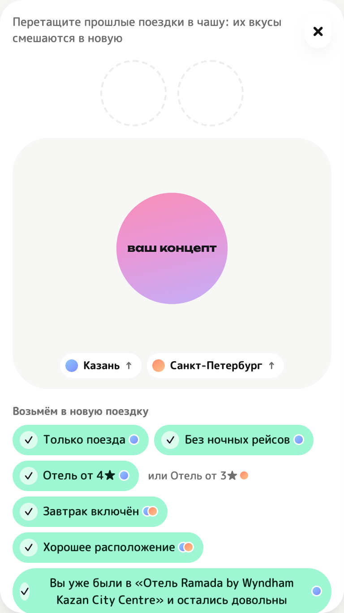</td>
<td width="50%">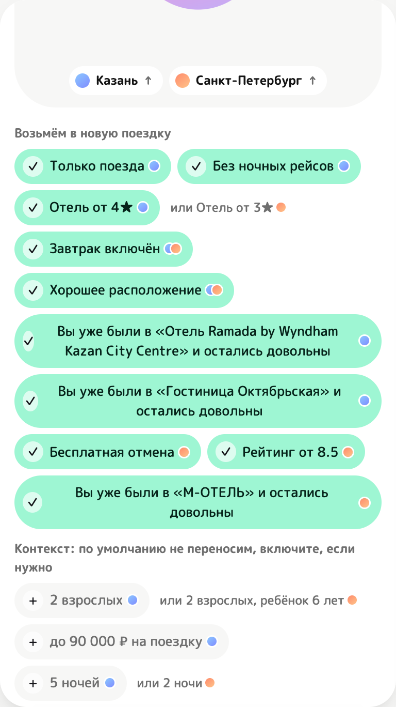</td>
</tr>
</table>

- **Tastes merge, they never overwrite.** "Breakfast included" from both trips becomes one chip with two coloured dots — one per source trip.
- **Conflicts are the user's call.** One trip wanted "4★ and up", the other "3★ and up": the chip shows the chosen variant and offers the other one next to it.
- **Context is offered, not applied.** The party, the budget and the length of a trip are off by default — silently carrying a family trip's party into a business trip is the classic way to get a wrong plan — but one tap switches them on, and they travel as editable text in your next message.
- **Everything is reversible.** Pull a trip's token out of the bowl and a drop tears away from the concept through a liquid neck; its tastes leave with it, the shared ones stay.
- **Provenance survives into the plan.** Inherited conditions are applied as soft ones, and the answer says where they came from; whatever you say in the new trip always wins.

The liquid is an SVG "goo" filter (a blur followed by a hard alpha threshold) over one group of shapes, all filled with a single gradient in shared coordinates, so two drops touching read as one mass. The full design, the API and the rules of what carries over are in [docs/trip-blend.md](docs/trip-blend.md); the history module behind it — ratings, a learned and erasable profile, templates with `extends` — is in [docs/trip-templates.md](docs/trip-templates.md).

## What else it looks like

| | |
|---|---|
| 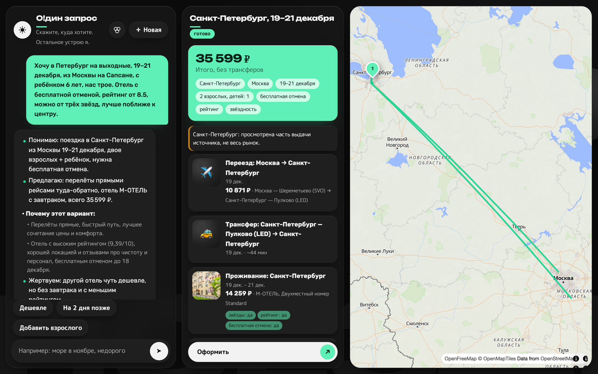 | 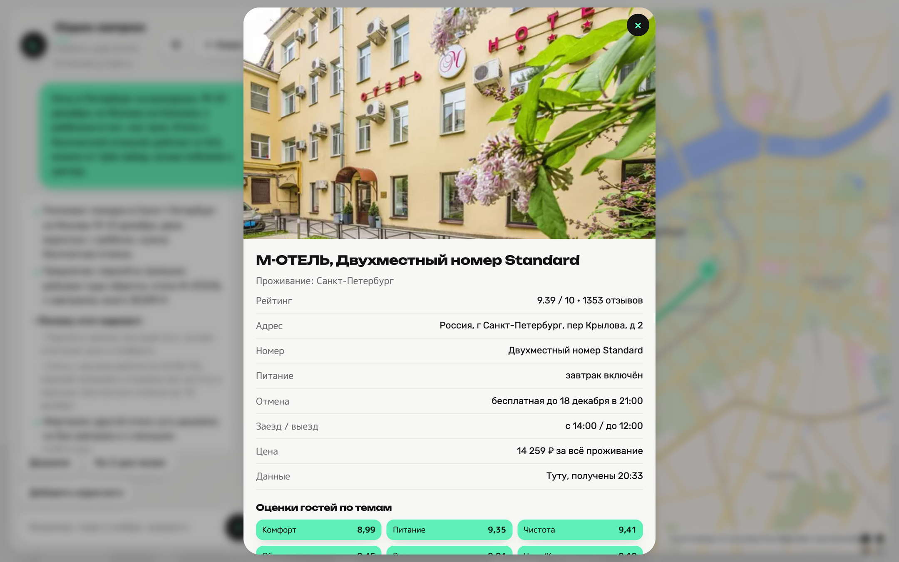 |
| Light and dark themes with one accent colour | Every node opens into a card: photos, guest ratings by topic, cancellation terms, where the data came from |

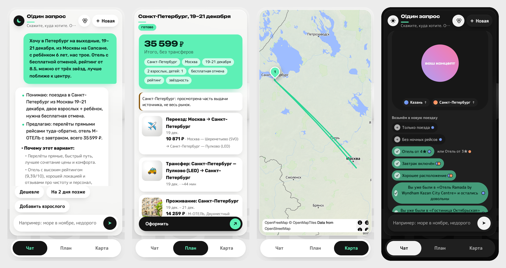

The interface is one static web app (vanilla JS, no build step) that works the same in a desktop browser, on a phone and as a **Telegram Mini App**: the bot opens it with the same plan, and in the bot itself you can rate a past trip in one tap.

## How it works

The modules (`chat`, `agents`, `history`, `trip_map`, `shared`) talk to each other only through the database and a shared contract of commands and events ([backend/chat/README.md](backend/chat/README.md)). The bot and the web UI put commands into a queue; the worker with the agents takes them and writes the plan and the events back.

### Overall architecture

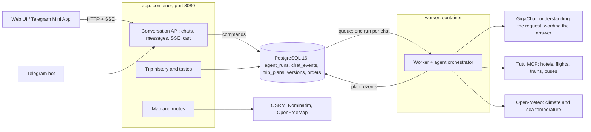

### The multi-agent pipeline: who is responsible for what

The LLM only understands text and words the answer. Everything that affects price, dates or the choice is computed by code.

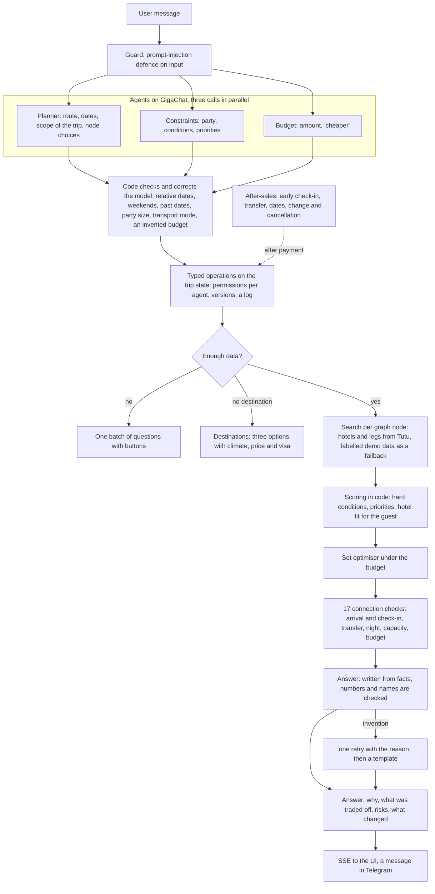

### The trip graph and re-planning

A trip is stored as a graph of nodes: stays and legs. Changing a condition marks only the affected nodes stale; the rest is not searched again.

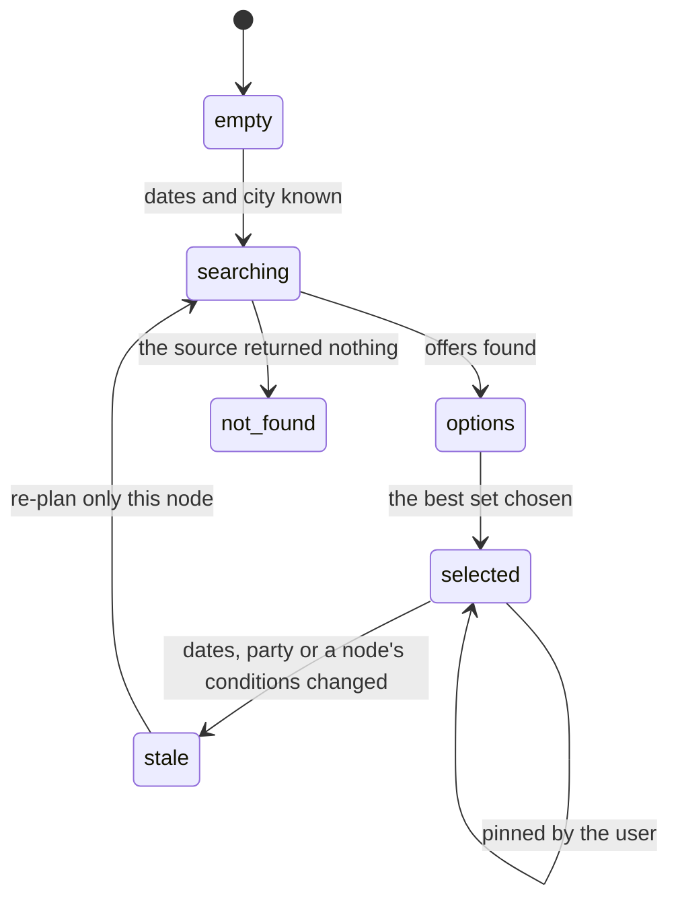

### Plan statuses and checkout

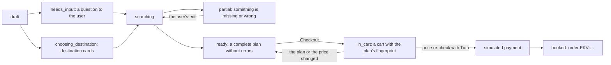

### What the agents actually do

- **Three parallel LLM calls per message** (route, constraints, budget) return small "deltas". Code turns them into typed operations (`set_dates`, `add_constraint`, `select_offer`…) with permission and version checks. The LLM never counts money and never writes paths into the state.
- **The trip graph**: stays and legs with stable ids. A changed condition marks only the affected nodes stale. Check-in is aligned to the arrival of the incoming leg.
- **Scoring in code**: hard conditions are `pass` / `fail` / `unknown` (unknown never counts as satisfied), options are ranked by the user's priorities, and the set of offers is chosen within the budget.
- **Connection checks** (`backend/agents/domain/checks.py`): arrival versus check-in, night and late arrivals, transfers, the buffer before a departure, changes, time zones, capacity, budget, the cancellation deadline, the freshness of a price.
- **The answer** is written by the LLM from the code's facts only; every number is checked, a mismatch gets one retry and then a template.
- **The queue**: one run per chat at a time; a question to the user does not hold the queue; a crashed worker returns the run to the queue from its checkpoint.

The original specification is [docs/PLAN.md](docs/PLAN.md); what was verified, what was not and how the code departs from the plan is in [docs/STATUS.md](docs/STATUS.md).

### Fit for the guest

Beyond price, stars and rating, code looks at whether a hotel suits this particular trip (`backend/agents/domain/hotel_fit.py`):

- **Ratings by topic** (cleanliness, comfort, location, service, value) from Tutu. A topic the user cares about goes into "why it fits"; a weak one (below 7 out of 10) goes into the risks.
- **A disappointment risk** (0…1): few reviews, a low rating, weak important topics, no free cancellation, unconfirmed facilities for children or pets. It lowers an option's score by up to 0.12.
- **Quotes from real reviews** of the chosen hotel, from similar guests first (a family reads families' reviews). Empty and suspicious reviews are dropped.
- **Bed type and the view** are ordinary conditions; matching rooms come first.

### Security and prompt injection

Four layers, none of which relies on the model behaving:

1. **Input**: attempts to reveal the prompt, "ignore your instructions", commands and role markup get a fixed refusal without calling the model and without touching the plan.
2. **Data**: names, addresses, amenities and reviews from external sources are cleaned (invisible characters, emoji, links, instruction-like text, length) before they reach the state and the prompt.
3. **Output**: the answer is replaced by a template if it contains a link or an email not present in the facts, the value of a secret, a code block or a copy of the system prompt. Numbers are checked against the facts.
4. **Structure**: prompts carry a safety preamble, response schemas are closed, agent permissions are limited, and the model writes nothing into the state except typed operations.

Tests: `backend/tests/test_guard.py`. This lowers the risk; it does not prove a bypass is impossible.

## What is live and what is a demo

We had no access to Ostrovok's own data, so:

| Data | Source | Status |
|---|---|---|
| Hotels, rates, prices, cancellation terms | Tutu MCP (`search_hotels`, `get_offer_details`) | **live**, read-only |
| Flights, trains, buses | Tutu MCP (`search_avia`, `search_rail`, `search_bus`) | **live**, read-only; stations are geocoded by name with Nominatim |
| Climate and sea temperature | Open-Meteo | **live** (last year's archive) |
| Road routes, the map, geocoding | OSRM, OpenFreeMap, Nominatim | **live** |
| Whatever Tutu did not return (`auto` mode), and `mock` mode | a generator | **demo**: `data_mode: mock`, a «демо» badge in the UI, a warning in the plan and the answer |
| Travel time from Moscow and the visa regime on destination cards | a reference table in code | for reference, marked as such in the UI |
| Payment and booking | — | **simulated**: no money is taken and nothing is booked with suppliers |

Tutu's MCP server answers only from Russian networks, and train tickets are on sale roughly 90 days ahead, so plans with rail legs far in the future come back partial.

## Running it

```bash
git clone https://github.com/i-safonoff/one-request-trip-agent
cd one-request-trip-agent
cp .env.example .env        # put your GIGACHAT_AUTH_KEY in it (developers.sber.ru)
docker compose up --build
# open http://localhost:8080
```

The first build takes a few minutes, later ones seconds. Only Docker and Compose are needed; database migrations run at start. On Apple Silicon the images run as `linux/amd64` through emulation; for a native build set `DOCKER_PLATFORM=linux/arm64` in `.env`.

**Response time:** 20–60 seconds on GigaChat's free tier (its three model calls run one after another).

| What | Without it |
|---|---|
| `GIGACHAT_AUTH_KEY` in `.env` | the app starts, `/ready` reports `llm: missing`, and the agent answers with an error |
| Access to `mcp.tutu.ru` (hotels and transport) | `auto` mode fills the gaps with demo data labelled «демо». `HOTELS_SOURCE=tutu` / `TRANSPORT_SOURCE=tutu` means live data only |

For the blending demo there is an optional seed: three finished trips (Japan, Turkey, Kazan) with ratings for your guest user.

```bash
make seed USER_ID=<user uuid>        # the id is in the users table or in the POST /api/v1/auth/guest response
```

### Routes

- `/` — the web UI (chat, plan, map, cart). Guest sign-in, no registration; the same address opens as a Telegram Mini App.
- `/health` — `200 {"status":"ok"}`; `/ready` — readiness of the database, the LLM and the sources.
- `/docs` — OpenAPI. Sign-in: `POST /api/v1/auth/guest` (browser) or `/auth/telegram` (Mini App). Chat: `GET /api/v1/chats/active`, `POST /api/v1/chats`, `POST /api/v1/chats/{id}/messages` (202, queued), `GET …/events` (SSE), `GET …/plan`. Checkout: `POST /api/v1/plans/{plan_id}/cart`, `POST /api/v1/carts/{id}/check|checkout`. Trip history and blending: [docs/trip-templates.md](docs/trip-templates.md).

### Scenarios to try

The requests are in Russian, the product's language; the translation is in brackets.

1. «Найди отели в Москве на 6-9 ноября для двух взрослых, завтрак и бесплатная отмена, до 30 000 за всё проживание» (hotels in Moscow for two adults, breakfast and free cancellation, up to 30,000 for the whole stay) — no questions, with "why" and "what was traded off".
2. «Хочу в Питер на выходные» (Saint Petersburg for the weekend) → one question (from where, how many of you) → legs, transfers, a hotel.
3. «К тёплому морю в ноябре, недорого, с ребёнком, без долгих перелётов» (a warm sea in November, cheap, with a child, no long flights) → three destinations with climate, travel time and price → a choice → a plan.
4. Re-planning: «сделай дешевле» (cheaper), «на два дня позже» (two days later), «с нами едет собака» (the dog is coming), «нас будет четверо» (there will be four of us), «оставь этот отель» (keep this hotel).
5. «Оформить» (Checkout) → price re-check → the form → simulated payment → order `EKV-…`.

### Telegram (optional)

Put a token from @BotFather into `TELEGRAM_BOT_TOKEN`: the bot starts by itself with long polling. After `/start` it offers an "Open the app" button with the chat, plan, map and cart in a Mini App; `/history` and `/profile` work in the chat itself. Without an https address the bot plans right in the chat (`/plan`, `/new`, `/status`).

The Mini App opens only over HTTPS. `docker compose --profile telegram up -d` starts `tunnel`, an SSH tunnel to localhost.run (port 22, no account). Its `https://….lhr.life` address changes on reconnect; the app picks up the new one within 20 seconds and updates the bot's button. Without the profile nothing is exposed.

### Configuration

Resources: 2 CPU, 2 GB RAM. Services in `docker-compose.yml`: `db` (PostgreSQL 16), `app` (API, UI, Telegram bot, port 8080), `worker` (agents), and optionally `tunnel` (the `telegram` profile). Only `GIGACHAT_AUTH_KEY` is required; everything else has a default (commented in [.env.example](.env.example)).

| Variable | Default | Purpose |
|---|---|---|
| `GIGACHAT_AUTH_KEY` | — | the GigaChat API authorisation key (**required**) |
| `GIGACHAT_SCOPE` | `GIGACHAT_API_PERS` | the key's scope |
| `GIGACHAT_MODEL` | `GigaChat-2-Max` | the model |
| `GIGACHAT_BASE_URL` | empty (the SDK's address) | another GigaChat endpoint |
| `GIGACHAT_VERIFY_SSL_CERTS` | `false` | the endpoint uses the Russian Ministry of Digital Development's root certificate; for strict checking set `GIGACHAT_CA_BUNDLE_FILE` |
| `GIGACHAT_CA_BUNDLE_FILE` | empty | path to the certificate for strict checking |
| `GIGACHAT_MAX_CONCURRENCY` | `1` | parallel LLM requests (the free tier answers parallel ones with 429) |
| `GIGACHAT_JSON_SCHEMA` | `false` | ask the model for `response_format: json_schema` (it breaks nested schemas) |
| `RUN_DEADLINE_SECONDS` | `150` | after how many seconds one agent request is stopped |
| `DATABASE_URL` | `postgresql+asyncpg://app:app@db:5432/app` (set by compose) | PostgreSQL; without Docker the default is a SQLite file |
| `SESSION_SECRET` | `change-me-in-production` | signs session tokens |
| `HOTELS_SOURCE` | `auto` | `auto` (live, labelled demo on failure) / `tutu` / `mock` |
| `TRANSPORT_SOURCE` | `auto` | the same for transport |
| `TUTU_MCP_URL` | `https://mcp.tutu.ru/mcp` | the Tutu MCP server |
| `WARM_SEA_MIN_C` | `22` | the "warm sea" threshold, °C |
| `NOMINATIM_ENABLED` | `true` | geocoding places outside the built-in catalogue |
| `TRIP_MAP_PROVIDER` | `maplibre` | the map: `maplibre` (no key) / `leaflet` / `google` |
| `TRIP_MAP_LANGUAGE` | `ru` | the language of map labels |
| `TELEGRAM_BOT_TOKEN` | — | optional: the bot and sign-in from the Telegram Mini App |
| `PUBLIC_BASE_URL` | `http://localhost:8080` | the public https address for the Mini App |
| `TELEGRAM_WEBHOOK_URL`, `TELEGRAM_WEBHOOK_SECRET` | — | a webhook instead of long polling |
| `DEV_AGENT` | `false` | a stub instead of the agents; leave it off |
| `HISTORY_ALLOW_EARLY_FEEDBACK` | `false` | accept a rating before the trip ends (for demos) |
| `HISTORY_HALF_LIFE_DAYS`, `HISTORY_MIN_CONFIDENCE` | `365`, `0.4` | decay and the confidence threshold of learned tastes |
| `GIGACHAT_TIMEOUT`, `TUTU_TIMEOUT` | `60`, `30` | the timeout of one GigaChat / Tutu MCP call, s |
| `RUN_STALE_SECONDS`, `WORKER_POLL_SECONDS` | `60`, `1.0` | seconds without a worker heartbeat before a run returns to the queue; the queue polling period |
| `USER_TZ` | `Europe/Moscow` | the user's time zone ("tomorrow", "the weekend") |
| `TELEGRAM_CHAT_MODE` | `auto` | `auto`: the Mini App with an https address, otherwise the chat; `miniapp` / `chat` to force one |
| `TRIP_MAP_STYLE_URL` | `https://tiles.openfreemap.org/styles/liberty` | the vector map style |
| `GOOGLE_MAPS_API_KEY`, `GOOGLE_MAPS_MAP_ID` | — | only for `TRIP_MAP_PROVIDER=google` |
| `TRIP_MAP_DATA_DIR`, `TRIP_MAP_FILE` | `data/trip_map`, an example trip | the geocoding cache; the map module's standalone demo trip |
| `DOCKER_PLATFORM` | `linux/amd64` | `linux/arm64` for a native run on Apple Silicon |

## Agent quality metrics

Thirteen scenarios (`backend/scripts/eval_scenarios.py`, results in [docs/metrics.md](docs/metrics.md)) were run against live GigaChat and Tutu, each as a new guest. A "complete plan" means every part is chosen, the price is computed and there are no connection errors.

| Scenario | Complete plan without errors | Outcome | Clarifications | To the first recommendation, s | Connection errors |
|---|---|---|---:|---:|---|
| Moscow: a complete request, hotels only | yes | ok | 0 | 17.3 | - |
| Saint Petersburg: an incomplete request | yes | ok | 1 | 11.2 | - |
| Saint Petersburg: a trip with edits | yes | ok | 0 | 7.2 | - |
| Russia: several cities | yes | ok | 0 | 25.5 | - |
| A vague request for the sea | no | directions | 0 | - | - |
| Japan: Tokyo and Osaka | no | partial | 0 | 45.9 | TRIP_DATES_MISMATCH |
| The sea: from a vague request to a plan | yes | ok | 1 | 73.3 | - |
| Bali for a week | yes | ok | 0 | 34.6 | - |
| Train only | yes | ok | 0 | 8.1 | - |
| A family with a dog in Sochi | yes | ok | 0 | 15.3 | - |
| A day trip "tomorrow" | yes | ok | 0 | 6.1 | - |
| By bus, no flights | yes | ok | 0 | 9.2 | - |
| Re-planning: four people, no breakfast | yes | ok | 0 | 9.2 | - |

- **11 of 13 complete plans without errors.** "A vague request for the sea" stops at choosing a destination (the agent waits for the user). "Japan: Tokyo and Osaka" stays partial: a late arrival shifts the stay, which is a connection error, and checkout is closed until the user writes «Принимаю даты» ("I accept the dates"), which the script does not do.
- **0.2 clarifications per scenario on average**, always in one message.
- **Median time to the first recommendation: 11.2 s**, the maximum 73 s (sea → choice → dates → plan, several turns in a row).
- One run on GigaChat's free tier, so the figures are indicative. To repeat: `python backend/scripts/eval_scenarios.py` (needs the running app and a key).

## Tests

```bash
cd backend && pip install -r requirements-dev.txt && pytest -q          # in-memory SQLite, no Docker
make test-db                                                            # the same tests on PostgreSQL (SKIP LOCKED, JSONB, partial indexes)
python backend/scripts/eval_scenarios.py                                # agent metrics (needs a GigaChat key and the running app)
```

About 400 tests: the domain core (operations, graph, scoring, budget, checks), the orchestrator against recorded Tutu responses and a scripted LLM, the API with the queue and SSE on a real PostgreSQL, the Telegram bot against a recording fake session, trip history and blending, the prompt-injection guard, and a regression test for every defect found by running the stack by hand.

## Layout

```
backend/main.py               the host: assembles the modules into one app
backend/chat/                 the Telegram bot and the conversation API
backend/history/              trip history, ratings, templates, blending
backend/agents/domain/        state, operations, graph, scoring, budget, checks, front-end JSON (pure code, no network)
backend/agents/runtime/       the worker, the orchestrator, the agents, search, the plan store, prompts
backend/agents/integrations/  the MCP client, hotels and transport (Tutu / demo), GigaChat, weather
backend/agents/shop/          the cart and the simulated payment
backend/agents/static/        the web UI (chat, plan, map, cart, the blend workshop)
backend/trip_map/             the map and routes
backend/shared/               settings, database, models, commands and events (the contract between modules)
backend/migrations/           Alembic (0001 chat, 0002 history, 0003 agents, 0004 one order per cart)
backend/scripts/              probe_tutu.py (MCP exploration), eval_scenarios.py (metrics), seed_history_demo.py
docs/                         the plan, the status, metrics, the history and blending designs, Tutu samples
```

## What I would do differently

- **Stations deserve real coordinates.** Tutu returns station names only, and Nominatim sometimes resolves them far away — in one run a Kazan station landed in Uzbekistan and dragged the route line across the map. A station catalogue with coordinates (or validating a geocoded point against the city's bounding box) would remove a whole class of map bugs.
- **One parser for the party size.** After blending, the context phrase "2 adults and a 6-year-old" was once read as one adult and one child. The party should be passed as structure, not round-tripped through the LLM as text.
- **The answer should be plain text or rendered Markdown, not both.** GigaChat sometimes formats its answer with Markdown headings and bold text, and the UI shows the raw markers. Either the prompt forbids Markdown and the guard enforces it, or the UI renders a safe subset.
- **The user's transport wish must survive the scoring.** A request for the Sapsan train once ended with a flight chosen, because the wish was understood as context rather than a condition. Explicit transport words deserve the same hard-condition treatment as "train only".
- **Implicit taste signals over ratings.** Few people rate trips. What a user edits ("cheaper", "closer to the centre") is a stronger and free signal; the plan's operation log already has it.
- **LLM latency is the product.** Three sequential GigaChat calls per message (20–60 s on the free tier) dominate the experience; a higher concurrency limit, or merging the three extractors into one call with a strict schema, would matter more than any UI change.
