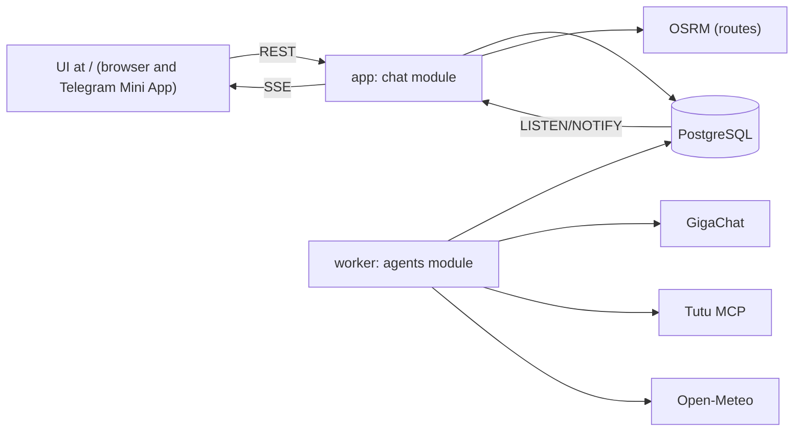

# Implementation plan: "One Request" (team ekvivalentno)

This document is the specification the code in this repository was written against. Everything chosen by default is collected in section 15; that is the place to disagree.

## 0. Fixed decisions

| Topic | Decision |
|---|---|
| Backend | One FastAPI project with `chat` and `agents` modules, one Docker image, two processes: `app` (API + UI) and `worker` (agents) |
| State | PostgreSQL 16: a run queue, a versioned plan, a full log of operations, events for SSE with catch-up |
| LLM | GigaChat through its native API (OAuth). The team hands the key to the jury |
| Data | The Tutu MCP server, live data. Mocks only where Tutu returns nothing (Japan, for example), clearly labelled in the JSON and the UI |
| Agents | A main agent plus six specialists: destinations, constraints, budget, hotels, transport, checks |
| Plan changes | Not a JSON Patch from the LLM but typed operations (section 3) |
| Scope of v1 | The whole path: inspiration → choosing a destination → search → comparison → assembly → cart → simulated payment, plus re-planning |
| Front end | One static UI at `/` (an evolution of `trip_map`), which also opens as a Telegram Mini App |
| Telegram | A bot made with BotFather (by the team), HTTPS through a cloudflared quick tunnel in a separate compose profile |
| Map | Roads (transfers, car) via OSRM. Rail and bus by the station coordinates from MCP when available, otherwise a straight line. Flights as an arc |
| Required scenarios | Moscow and Saint Petersburg; a multi-city trip across Russia. Japan: check Tutu's coverage, otherwise labelled mocks |

## 1. Architecture



### The queue and runs (`agent_runs`)

- `POST /messages` stores the message, creates `agent_runs(status=queued)` and returns `202`.
- The worker takes a task with `SELECT … FOR UPDATE SKIP LOCKED`, on the condition that the chat has no `running` run (enforced by a partial unique index on `chat_id` for `running`).
- Lifecycle: `queued → running → (waiting_user | done | failed)`. `waiting_user` frees the chat's queue.
- Messages of one chat are processed strictly in order. A new message during a search waits in `queued`.
- A heartbeat every 10 s. A run without a heartbeat for more than 60 s goes back to `queued`.
- Checkpoints: after each agent step the result is written to `agent_runs.checkpoint`, and after a restart the worker continues from the last step. MCP responses are cached in `offers`, so a retry is cheap.
- Idempotency: a `client_message_id` from the front end, unique within the chat.

### Events

- The worker writes a row to `chat_events` (`seq` is a bigserial) and issues `NOTIFY chat_events, '<chat_id>'` in the same transaction.
- The API runs `LISTEN` and fans events out to SSE subscribers.
- On reconnect the client sends `Last-Event-ID`, and the API reads `seq > id` from the database.
- Event types: `request.queued`, `agent.progress`, `clarification.required`, `destinations.ready`, `plan.updated`, `plan.ready`, `assistant.message`, `cart.updated`, `order.paid`, `request.failed`.
- Every plan event carries `plan_id`, `revision` and `changed_node_ids`. The front end fetches the plan version itself.

## 2. Agents

In every agent, numbers, dates, sums, time zones and checks are computed by **code**. The LLM decides only what needs an understanding of language.

| Agent | LLM | Code | Operations it writes |
|---|---|---|---|
| **Main** | Understanding the message (new trip / change / choice / question), decomposing the route, deciding what to ask, the final answer with its "why" | Picking specialists from the dependency graph, assembling facts for the answer, checking the text against the JSON | Structure: places, nodes, order, dates, questions, pins |
| **Destinations** | Ranking candidates against the wishes and wording the reasons | Filtering the catalogue by climate (Open-Meteo), travel time, tags; probe prices through Tutu | `set_destination_candidates` |
| **Constraints** | Extracting the party, mandatory conditions, exclusions and priorities, with quotes | Normalisation (children's ages, pets), finding the affected nodes | `set_party`, `add_constraint`, `remove_constraint`, `set_priorities` |
| **Budget** | Interpreting the budget ("up to 30 thousand for everything", "cheap"), a saving strategy | Price per night and in total, the full cost, optimising the set of offers under the budget | `set_budget`, `select_offer` (when optimising) |
| **Hotels** | Only for soft wishes that MCP filters do not cover ("quiet", "near the centre"): judging by the description | `search_hotels` parameters, `get_offer_details`, filtering hard conditions at the rate level, scoring | `attach_options` for `stay` nodes |
| **Transport** | None | Searching flights, trains and buses through MCP, segments, times, transfers (OSRM) | `attach_options` for `transport`/`transfer`, `ensure_transfer` |
| **Checks** | None | Rules for connections and conditions (section 6) | `set_checks` |

Only independent steps run in parallel: constraints ‖ budget, hotels ‖ transport. All GigaChat calls go through a `GIGACHAT_MAX_CONCURRENCY` semaphore, set from the account's real limits.

### Processing one message

```text
1. Main: classify the message and draft the structural operations
2. Constraints ‖ Budget: operations in their own areas
3. PlanService.apply → a new revision → the dependency graph marks nodes stale
4. Blocking gaps? → Main forms ONE question (possibly with options) → waiting_user
5. No destination chosen? → Destinations agent → 3 cards → waiting_user (choice)
6. Hotels ‖ Transport: only stale nodes and nodes without options
7. Budget: choose the set of offers (respecting pinned ones)
8. Checks: connection rules; an error → step 6 for the affected nodes (at most 2 iterations)
9. Main: the answer (section 4) → check the text against the JSON → assistant.message + plan.ready
```

## 3. Typed operations instead of JSON Patch

The LLM does not write paths like `/nodes/stay_tokyo/check_in`. An agent returns a list of operations from a closed set. It is a Pydantic discriminated union on the `op` field, and every operation is validated separately.

```json
{
  "base_revision": 6,
  "ops": [
    {"op": "set_dates", "node_id": "stay_spb", "check_in": "2026-11-16", "check_out": "2026-11-18",
     "source": {"message_id": "m12", "quote": "а если на два дня позже"}},
    {"op": "add_constraint", "id": "pets", "kind": "pets_allowed", "value": {"type": "dog"},
     "strength": "hard", "source": {"message_id": "m13", "quote": "с нами едет собака"}}
  ]
}
```

The quotes are the user's words in Russian ("what if two days later", "our dog is coming with us").

The set of operations:

| Group | Operations |
|---|---|
| Trip | `set_scope`, `set_origin`, `set_party`, `set_budget`, `set_priorities` |
| Conditions | `add_constraint`, `remove_constraint`, `relax_constraint` (only after the user agrees) |
| Graph | `add_place`, `add_node`, `remove_node`, `update_node`, `set_dates`, `reorder`, `ensure_transfer` |
| Offers | `attach_options`, `select_offer`, `pin_offer`, `unpin_offer` |
| Dialogue | `ask`, `resolve_question`, `set_destination_candidates`, `choose_destination` |
| Checks | `set_checks` |

`PlanService.apply(agent, base_revision, ops)` runs in one transaction:

1. **Permissions:** an agent may use only its own operations (the table in section 2).
2. **Version:** if `base_revision` is stale, operations touching fields changed after it are rejected and the rest are applied.
3. **Application** to the `TripState` Pydantic model and invariant checks: references to places, `check_out > check_in`, order, currency.
4. **Dependencies** (code, not the LLM): which nodes became `stale`.
5. **Write:** `trip_plans` (new `state_json` and `view_json`), a snapshot in `trip_plan_versions`, every operation in `plan_operations` (who, when, `base_revision`, the quote), a `plan.updated` event.

If the LLM returns invalid operations: one retry with the validation error in the prompt, then `request.failed` with an understandable reason.

### Dependency rules

| Change | What becomes stale | What we do |
|---|---|---|
| A node's dates | That node, the neighbouring legs, the following stays if the shift cascades | A new search for the affected nodes |
| The party | Every node with a price | A new search (room capacity, number of tickets) |
| The budget | Nothing | Re-select among existing options; search only if none fits |
| A hard condition added | Nodes where the chosen option is `fail` or `unknown` on it | Re-filter the options; search if there are too few |
| A hard condition removed | Nothing | Widen the search (cheaper options may appear) |
| Priorities | Nothing | Re-sort only |
| A pinned offer (`pin`) | Not touched | If it breaks a new hard condition, ask the user |

## 4. What we return: the main agent's answer and the JSON for the front end

Every run produces **a pair bound to one revision**:

- `chat_messages`: the main agent's answer (`AgentTurn`), with `plan_revision`;
- `trip_plans.view_json`: data for the map, the cards and the cart of that same revision.

### 4.1 The main agent's answer (`AgentTurn`)

The main agent receives **a fact pack** assembled by code: the chosen offers, the scoring criteria, the differences from the alternatives, the check results, the changes since the previous revision. It may write only from these facts.

```json
{
  "plan_revision": 7,
  "kind": "plan | question | destinations | change | checkout",
  "text": "Собрал поездку в Петербург на 14–16 ноября для двоих…",
  "understood": [
    {"field": "dates", "value": "14–16 ноября", "origin": "user"},
    {"field": "origin", "value": "Москва", "origin": "user"},
    {"field": "budget", "value": "до 40 000 ₽ за всю поездку", "origin": "user"}
  ],
  "recommendations": [
    {
      "node_id": "stay_spb",
      "offer_id": "off_7649055_r2",
      "why": ["Завтрак и бесплатная отмена до 13 ноября 15:00", "9,05/10 по 596 отзывам", "550 м до метро"],
      "tradeoffs": [
        {"vs_offer_id": "off_7652103_r1", "text": "На 870 ₽ дороже New City Inn, но рейтинг выше на 1,1"}
      ],
      "risks": ["Заселение с 14:00, поезд приходит в 07:10 — нужен ранний заезд или камера хранения"]
    }
  ],
  "changes": [
    {"node_id": "stay_spb", "before": "Rosso Riva, 19 259 ₽", "after": "Cosmos Smart, 17 265 ₽", "delta": "-1994.00"}
  ],
  "questions": [],
  "quick_replies": ["Дешевле", "На 2 дня позже", "Добавить взрослого", "Оформить"]
}
```

The values are in Russian, the language of the product.

The shape of the answer text:

1. **What I understood**: one line; assumptions are marked.
2. **What I suggest**: the summary: route, dates, total and how complete the calculation is.
3. **Why**: by this user's priorities, two or three points per key node.
4. **What was traded off**: a comparison with the nearest alternative, in numbers.
5. **Risks**: check warnings, unverified conditions, mock data, incomplete search.
6. **What changed**: only when re-planning: before → after, the price difference.
7. **Next step**: one question or quick replies.

Checked by code before sending: every sum, date and hotel name in `text` must be in the fact pack. On a mismatch: one regeneration, then a template answer without the LLM.

### 4.2 The JSON for the front end (`view_json`)

Compatible with the current `trip_map` schema (`places` + `nodes` + `sequence` + `offers`) and extending it.

```json
{
  "schema_version": 2,
  "plan_id": "…", "revision": 7,
  "status": "draft | searching | needs_input | choosing_destination | ready | partial | in_cart | booked",
  "title": "Петербург, 14–16 ноября",
  "trip": {"kind": "city | multi_city", "origin": "msk", "date_from": "2026-11-14", "date_to": "2026-11-16",
           "party": {"adults": 2, "children_ages": [], "pets": []}},
  "budget": {"amount": "40000.00", "currency": "RUB", "scope": "trip"},
  "pricing": {"known_subtotal": "35120.00", "total": "35120.00", "is_complete": true,
              "missing": [], "within_budget": true},
  "priorities": [{"key": "price", "weight": 0.4, "origin": "user", "quote": "недорого"}],
  "constraints": [{"id": "breakfast", "strength": "hard", "label": "Завтрак"}],
  "places": {"spb": {"name": "Санкт-Петербург", "lat": 59.94, "lon": 30.31, "tz": "Europe/Moscow"}},
  "sequence": ["outbound", "transfer_in", "stay_spb", "return"],
  "nodes": {
    "stay_spb": {
      "type": "stay", "status": "selected | options | stale | searching | not_found",
      "place": "spb", "check_in": "2026-11-14", "check_out": "2026-11-16",
      "selected_offer_ref": "off_7649055_r2", "pinned": false,
      "options": [
        {"offer_id": "off_7649055_r2", "rank": 1, "score": 0.82,
         "criteria": {"price": 0.71, "rating": 0.9, "location": 0.8, "cancellation": 1.0, "meal": 1.0},
         "constraints": {"breakfast": "pass", "free_cancellation": "pass", "pets_allowed": "unknown"}}
      ]
    },
    "outbound": {
      "type": "transport", "mode": "rail", "from": "msk", "to": "spb",
      "selected_offer_ref": "off_rail_…",
      "geometry": {"type": "LineString", "coordinates": [[37.65, 55.77], [30.36, 59.93]]},
      "geometry_status": "routed | stations | straight | great_circle"
    }
  },
  "offers": {
    "off_7649055_r2": {
      "kind": "hotel_rate", "source": "tutu_mcp", "data_mode": "live | mock",
      "retrieved_at": "2026-10-27T15:02:11Z",
      "hotel": {"name": "Cosmos Smart Москва Дубининская", "stars": 3, "rating": 9.05, "review_count": 596,
                "address": "…", "lat": 55.72, "lon": 37.63, "photos": [], "amenities": [],
                "check_in_time": "14:00", "check_out_time": "12:00"},
      "rate": {"room_name": "Стандартный, двуспальная кровать", "meal": "breakfast",
               "free_cancellation_until": "2026-11-13T12:00:00Z",
               "price": {"amount": "17265.00", "currency": "RUB", "basis": "stay_total"}}
    }
  },
  "checks": [
    {"code": "EARLY_ARRIVAL", "severity": "warning", "node_ids": ["outbound", "stay_spb"],
     "facts": {"arrival_local": "2026-11-14T07:10+03:00", "check_in_time": "14:00", "wait_hours": 6.3},
     "suggestion": "Ранний заезд или хранение багажа"}
  ],
  "changes": {"from_revision": 6, "changed_node_ids": ["stay_spb"]},
  "questions": [{"id": "q3", "text": "Откуда выезжаете?", "options": ["Москва", "Санкт-Петербург"], "field": "origin"}],
  "destination_candidates": [],
  "cart": {"status": "empty | draft | checked | paid", "items": [], "total": null},
  "data_notes": [{"scope": "stay_tokyo", "kind": "mock", "text": "Синтетические данные: Туту не отдаёт отели Японии"}]
}
```

Money is stored as a decimal string. Coordinates in `geometry` follow GeoJSON order `[lon, lat]`; when there are none we write `null`, never the city centre.

## 5. Comparison and ranking (code)

1. **Hard conditions** filter at the rate level (`pass` / `fail` / `unknown`). `unknown` does not count as satisfied: such an option stays only with a risk flag and, if there is nothing else, with a question to the user.
2. **Scoring:** `score = Σ weight_i · criterion_i`, all criteria normalised to 0..1:
   - hotels: price, rating (adjusted for the number of reviews), distance to the centre or a point of interest, cancellation flexibility, food, stars;
   - transport: price, travel time, number of changes, convenience of departure and arrival times, luggage.
3. **Weights:** defaults first, then the constraints agent adjusts them from the user's words ("cheap" → price ↑, "with a child" → food and travel time ↑, "no long flights" → travel time ↑ plus a hard limit).
4. **Trade-offs:** for the chosen option, code computes the difference on every criterion against the two nearest alternatives. These are the facts behind "what was traded off".
5. **Budget:** choosing the set of offers across all nodes maximises the total score subject to `total ≤ budget`. Search with pruning: at most 10 options per node, at most 8 nodes. Pinned offers are fixed.

## 6. Connection rules (the checks agent)

All times are stored with a time zone. A place's zone comes from its coordinates (`timezonefinder`, offline); comparisons are made in UTC and shown in local time.

| Code | Rule | Level |
|---|---|---|
| `DATES_STAY_ARRIVAL` | a stay's `check_in` equals the arrival date of the incoming leg (local time) | error |
| `DATES_STAY_DEPARTURE` | `check_out` equals the departure date of the outgoing leg | error |
| `NIGHTS_COVERAGE` | every night of the trip is covered by a stay or an overnight leg; stays do not overlap | error |
| `PLACE_CHAIN` | `transport.to` matches the next stay's place (or a place nested in it); otherwise a `transfer` is needed | error |
| `MISSING_TRANSFER` | the arrival airport or station is not the hotel and there is no transfer → `ensure_transfer` | warning |
| `EARLY_ARRIVAL` | arrival plus transfer is more than 3 h before `check_in_time` | warning |
| `NIGHT_ARRIVAL` | arrival plus transfer between 00:00 and 06:00: the night before check-in is not paid, or the hotel has no 24-hour front desk | warning |
| `LATE_CHECKIN` | arrival plus transfer after 23:00, a 24-hour front desk not confirmed | warning |
| `LATE_DEPARTURE_GAP` | more than 4 h between `check_out_time` and leaving for the airport or station | info |
| `DEPARTURE_BUFFER` | leaving the hotel = departure − transfer − buffer (flights: 2 h domestic / 3 h international; rail: 30 min; bus: 20 min); earlier than 05:00 → warn | warning |
| `CONNECTION_TIME` | a change: flights at the same airport ≥ 60 min (domestic) / 90 min (international); a change of airport or station ≥ transfer + 90 min | error |
| `TZ_DATE_SHIFT` | the local arrival date differs from the departure date (flights east, overnight trains): check the stay dates | info |
| `PARTY_CAPACITY` | room capacity ≥ the party; number of tickets = number of travellers; children's ages known where they affect the fare | error |
| `BUDGET` | the total ≤ the budget of its scope; with an incomplete calculation, `is_complete=false` rather than "fits" | error / warning |
| `CANCELLATION_EXPIRED` | the free cancellation deadline has already passed | warning |
| `OFFER_STALE` | `retrieved_at` older than 30 min → re-check before the cart | info, an error before payment |
| `CONSTRAINT_UNKNOWN` | a hard condition is `unknown` on the chosen option | warning |

Errors (`error`) block the `ready` status: the main agent sends the affected nodes back for re-selection (at most 2 iterations) and then honestly shows what does not fit. Warnings go to "Risks".

## 7. The destinations agent

- **A catalogue** `data/destinations.yaml`, about 30 destinations:
  - Russia: Moscow, Saint Petersburg, Kazan, Sochi, Kaliningrad, Mineralnye Vody, Murmansk, Irkutsk/Baikal, Altai, Dagestan, Vladivostok…
  - Abroad: Antalya, Hurghada, Sharm el-Sheikh, Dubai, Phuket, Nha Trang, Sri Lanka, the Maldives, Tbilisi, Yerevan, Samarkand, Tokyo/Osaka/Kyoto…
  - Fields: coordinates, IATA codes and stations, tags (sea, mountains, city, children, food), reference travel time from Moscow, the visa regime for Russian citizens. Reference fields are marked as static.
- **Climate:** Open-Meteo. Monthly mean air temperature and precipitation from past years' archive; sea temperature from the Marine API. Cached in `climate_cache`.
- **Pipeline:** hard filters in code (the month, "warm sea" → water ≥ 24 °C, "no long flights" → ≤ 5 h) → the LLM picks 3 candidates and writes the reasons → a probe price through Tutu (the cheapest hotel for a typical stay, a flight if there is one) → cards: why, weather, travel time, a price guide, the source of the price (`live` / `mock`).
- The user picks a card → `choose_destination` → the main agent decomposes the trip.

## 8. Cart and simulated purchase

- The cart is built from the chosen offers of the current revision: `POST /plans/{id}/cart`.
- `POST /cart/{id}/check`:
  - re-checks prices and availability through MCP (`get_offer_details` for hotels, a repeated search for transport);
  - runs every check, including `OFFER_STALE`;
  - shows price changes; check errors block payment.
- `POST /cart/{id}/checkout`: a guest form (full name, email; the data goes nowhere) → "Pay" → a simulated payment → `orders(status=paid_mock, number=EKV-XXXXXX)` → the plan becomes `booked` → an `order.paid` event.
- Tutu tools that create carts or orders (`register_checkout_passengers`, creating checkout links) are **never called**. The MCP adapter passes only tools from an allow-list (read-only). According to Tutu's own instructions, flight registration creates a real unpaid order, so the ban is strict.

## 9. Tutu MCP and other sources

- `agents/integrations/tutu_mcp.py`: an MCP client over streamable HTTP with a session, timeouts, retries and a tool allow-list.
- Tools known from earlier exploration: `search_hotels`, `get_offer_details`, `get_hotels_instructions`, `fetch_resource`, `get_rail_seatmap`. The names and schemas of the transport tools are captured in stage 0.
- Normalisation into `offers`: the price basis (per night / in total / per person), currency, times with a zone, cancellation terms, `retrieved_at`, the raw response.
- Lessons from an earlier run:
  - `price_max` in `search_hotels` is per night;
  - breakfast and cancellation are checked at the rate level;
  - details need a `hotel_id`, not a `tutu_offer_id`.
- **Network:** `mcp.tutu.ru` and `tutu.ru` fail the TLS handshake from a foreign IP (checked on 27.10 from a Finnish IP). Development, the demo and the jury's run happen from a Russian IP without a VPN.
- Mocks only for what Tutu does not return: `mocks/`, labelled `data_mode: "mock"`. Mixing mocks into live data without a label is not allowed.
- For tests: recorded MCP and GigaChat responses (`tests/fixtures/`); the demo does not use them.

## 10. GigaChat

- `agents/integrations/llm.py`: the official GigaChat Python client, authorisation by key → an OAuth token, refreshed automatically.
- A structured answer by JSON Schema (the operations of section 3), then a second Pydantic validation.
- To check in stage 0:
  - which models the account has;
  - the limit on parallel requests (→ `GIGACHAT_MAX_CONCURRENCY`);
  - whether the image needs the Russian Ministry of Digital Development root certificate for TLS;
  - whether the model copes with our operation schema (schema size, nesting).
- Prompts live in `agents/runtime/prompts/*.md`. They grew out of the earlier prompts: a main agent with decomposition and specialists with a shared contract. The difference: the output is typed operations, not a JSON Patch.

## 11. HTTP API

| Method and path | Purpose |
|---|---|
| `GET /` | UI (browser and Mini App) |
| `GET /health` | 200 `{"status":"ok"}` |
| `GET /ready` | database availability; GigaChat and MCP are reported as `degraded` |
| `POST /api/v1/auth/telegram` | checks `initData` (an HMAC keyed by the bot token) → a session |
| `POST /api/v1/auth/guest` | a guest session for `localhost:8080` |
| `POST /api/v1/chats` | a new chat |
| `GET /api/v1/chats/{id}/messages` | history |
| `POST /api/v1/chats/{id}/messages` | a message → `202` (`client_message_id` for idempotency) |
| `POST /api/v1/chats/{id}/clarifications/{qid}/answers` | an answer by button |
| `POST /api/v1/chats/{id}/destinations/{key}/choose` | choosing a destination |
| `POST /api/v1/plans/{id}/nodes/{node}/select` | choosing an alternative by hand (= `select_offer` + `pin_offer`) |
| `GET /api/v1/chats/{id}/events` | SSE with `Last-Event-ID` |
| `GET /api/v1/chats/{id}/plan` | the current `view_json` |
| `GET /api/v1/plans/{id}/versions/{rev}` | a specific revision |
| `POST /api/v1/plans/{id}/cart`, `POST /api/v1/carts/{id}/check`, `POST /api/v1/carts/{id}/checkout` | cart and simulated payment |
| `GET /trip-map/api/route` | a road route (from `trip_map`) |

## 12. Database

| Table | Contents |
|---|---|
| `users` | a Telegram id or a guest |
| `chats` | owner, active plan |
| `chat_messages` | role, text, `AgentTurn` (jsonb), `plan_revision`, `client_message_id` |
| `agent_runs` | the queue: status, heartbeat, checkpoint, error |
| `trip_plans` | `state_json`, `view_json`, `revision`, `status` |
| `trip_plan_versions` | snapshots per revision |
| `plan_operations` | the operation log: agent, `base_revision`, `op` (jsonb), source, result (applied / rejected) |
| `clarifications` | question, fields, options, answer |
| `offers` | the normalised offer, the raw response, `source`, `data_mode`, `retrieved_at` |
| `carts`, `orders` | cart and simulated order |
| `chat_events` | `seq` bigserial, type, payload |
| `climate_cache`, `route_cache` | Open-Meteo and OSRM caches |

Migrations are Alembic and run automatically when `app` starts.

## 13. Front end (`/`, also the Mini App)

An evolution of `backend/trip_map/static`, vanilla JS, no build step.

- **Layout:** chat + map + route; on a phone the map on top and the chat as a sheet below.
- **Chat:**
  - messages with "Why / What was traded off / Risks / What changed" blocks;
  - quick replies and option buttons in questions;
  - a progress line from `agent.progress`.
- **Node cards:**
  - the chosen option and the alternatives with condition badges (`pass` / `fail` / `unknown`) and manual choice;
  - check warnings on the node;
  - a `mock` badge on synthetic data.
- **Destination cards:** weather, travel time, a price guide, a "Choose" button.
- **Cart:** items, total, price check, the form, "Pay", the order screen.
- **Telegram:** if `window.Telegram.WebApp` exists, `initData` → `/auth/telegram`, the theme from `themeParams`, `MainButton` for "Checkout". Otherwise a guest session.
- **Safety:** plan data is inserted only through `textContent` (as `trip_map` already does).

## 14. Running it, and the rules of the competition

- **`docker-compose.yml`:**
  - `db`: `postgres:16.x-alpine`, a pinned version, with a healthcheck;
  - `app`: `8080:8080`, `depends_on: db (healthy)`, a healthcheck on `/health`;
  - `worker`: the same image, command `python -m agents.runtime.worker`;
  - `tunnel`: the `telegram` profile, an HTTPS tunnel → `app:8080`; its URL is printed to the logs.
- **`Dockerfile`:** multi-stage, a pinned `python:3.12-slim`, an unprivileged user, `platform: linux/amd64` in compose, dependencies with exact versions.
- **`.env.example`:** `DATABASE_URL`, `GIGACHAT_AUTH_KEY=`, `GIGACHAT_SCOPE`, `GIGACHAT_MODEL`, `GIGACHAT_MAX_CONCURRENCY`, `TUTU_MCP_URL=https://mcp.tutu.ru/mcp`, `TELEGRAM_BOT_TOKEN=`, `TRIP_MAP_*`.
- **`README.md`** following the organisers' template: description, video, quick start, variables, routes, demo scenarios, what is live and what is mocked, the Russian-IP requirement for MCP.
- **Makefile:** `up`, `down`, `logs`, `test`, `tunnel`.
- **Submission:** logs to stdout, the module branches merged into `main`, a `submission` tag on the last commit of `main`, the video opening in a private window.

## 15. Defaults (correct them if they are wrong)

- The departure city is never assumed: if transport is needed, it is asked together with the other blocking questions in one message.
- An offer stays fresh for 30 minutes; a re-check before payment is mandatory.
- Departure buffers: flights 2 h domestic / 3 h international, rail 30 min, bus 20 min. Minimum connection: 60 / 90 min.
- "Warm sea" = water ≥ 24 °C; "no long flights" = ≤ 5 h, unless the user gave their own number.
- The interface and the answers are in Russian.
- Payment form data is not validated as real and is sent nowhere.
- The separate destinations agent runs only when no destination is named or it is named too broadly ("to the sea", "to Asia").

## 16. Order of work

| # | Stage | Done when |
|---|---|---|
| 0 | Checking the sources from a Russian IP: the MCP tool list and schemas, coverage of Moscow and Saint Petersburg (hotels, rail, flights), station coordinates in segments, Japan; GigaChat: key, model, limits, certificate | `docs/sources/` with real responses and a decision on Japan |
| 1 | Skeleton: compose (`db`, `app`, `worker`, `tunnel`), Dockerfile, Alembic, `/health`, `/ready`, README, Makefile, merging `trip_map` into `main` | `docker compose up --build` → `localhost:8080` opens the map of the example |
| 2 | Contracts: `TripState`, operations, `view_json`, `AgentTurn`, events; example JSON for 5 scenarios | the examples validate and the front end renders them without a backend |
| 3 | `PlanService`: permissions, versions, invariants, dependencies, the log | unit tests for every dependency rule and revision conflict |
| 4 | Chat, queue, worker, SSE with catch-up, guest session | a duplicate message does not create a run; a worker restart resumes the task; SSE catches up on what was missed |
| 5 | MCP and GigaChat adapters, normalisation, fixtures | a live Moscow search through the adapter matches a manual run |
| 6 | Main agent, constraints, budget, questions | a complete request gets 0 questions; an incomplete one gets 1 message of questions |
| 7 | Hotels, transport, scoring, budget optimisation | options with scores and `pass`/`fail`/`unknown` per condition |
| 8 | The checks agent: every rule of section 6 | a test per rule; a night arrival and connections are caught |
| 9 | The main agent's answer + checking it against the JSON | not a single number in the text that is not in the facts |
| 10 | Re-planning: cheaper, ± days, + adults, a dog, "keep this hotel" | untouched nodes do not change; a "What changed" block is present |
| 11 | The destinations agent, the catalogue, Open-Meteo | "a warm sea in November with a child" → 3 cards with weather and price |
| 12 | Cart and simulated payment | the path from the first message to `EKV-…` |
| 13 | Front end: chat, cards, alternatives, cart, destinations (in parallel with 5–12, on the examples from stage 2) | every scenario can be clicked through in a browser |
| 14 | Map: rail geometry by stations, car and transfers through OSRM, otherwise a straight line | every leg has a `geometry_status` |
| 15 | Telegram: `initData`, theme, `MainButton`, the `tunnel` profile | the Mini App opens from the bot and passes a scenario |
| 16 | Metrics (extra): a set of 20–30 test requests, the share completed, the number of clarifications, time to the first recommendation, connection errors; the video; the `submission` tag | a metrics report in the README, the tag set |

## 17. Acceptance scenarios

1. «Найди отели в Москве на 6–9 ноября для двух взрослых, завтрак и бесплатная отмена, до 30 000 за всё» ("Find hotels in Moscow for 6–9 November for two adults, breakfast and free cancellation, up to 30,000 in total"): no questions, stays only, no transport.
2. «Хочу в Питер на выходные» ("I want to go to Saint Petersburg for the weekend"): one question (from where and which weekend), then a train + a hotel + transfers.
3. «Хочу куда-нибудь к тёплому морю в ноябре, недорого, с ребёнком, без долгих перелётов» ("Somewhere by a warm sea in November, cheap, with a child, no long flights"): one question (from where, the child's age), 3 destinations, a choice, a plan.
4. «Москва → Казань → Нижний Новгород, 7 дней, двое» ("Moscow → Kazan → Nizhny Novgorod, 7 days, two of us"): a multi-city graph and its connections.
5. Re-planning on top of 2 and 4: "what if two days later", "make it cheaper", "our dog is coming", "there will be four of us", "keep this hotel".
6. Purchase: cart → price re-check → simulated payment → an order number.
7. Tokyo + Osaka: live data, or mocks with a label.
8. MCP unavailable: an understandable error, and the plan is not damaged.
