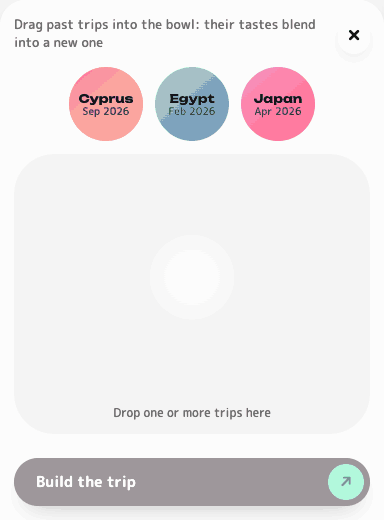
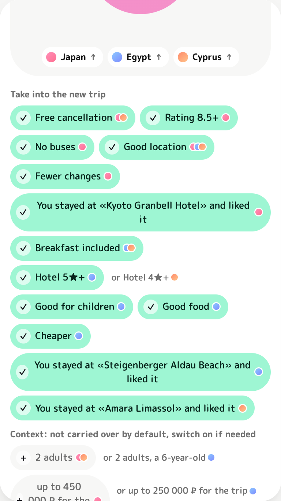

# A new trip from past ones: blending Japan, Egypt and Cyprus

The screen where the user "pours" past trips (flat coloured drops) into a bowl, and their tastes blend into the concept of a new trip. It is the showcase of the history module (`backend/history`; the design and the review of the idea are in [trip-templates.md](trip-templates.md)): what the system remembers about past trips is visible, under the user's control, and applied with one gesture.



*The screenshots show an English rendering of the Russian UI (see the note in the [README](../README.md)).*

## Why a gesture and not a list

The track requires that the system remembers past trips and takes them into account. A list of "keep breakfast? keep free cancellation?" solves that, but does not explain where the items came from. The gesture "I dragged Japan into the new trip" explains provenance by itself: every taste in the concept carries the coloured dot of the trip it came from. A drop can be pulled back out, and its tastes leave with it. That makes the memory reversible rather than magical.

## What it looks like

1. The chat header has a button with three circles ("Build a trip from past ones"). It opens the workshop over the whole chat column; the conversation comes back when it closes.
2. **The shelf**: past trips as flat drops with a two-tone gradient (title, month and year). Each trip has its own pair of colours. The current trip is not on the shelf.
3. **The bowl**: a drop thrown into it pours into the concept like liquid: as it arrives it merges through a neck, like mercury, the concept grows and its colour flows into a mix of all the trips inside. The drop is absorbed whole, so the concept is always a clean circle, only larger and of a different colour. Below it are tokens for the trips inside ("Japan ↑", "Egypt ↑"). The empty place on the shelf stays as a dashed circle, so it is clear where the drop will return.
4. **Ingredients** below the bowl, in two groups:
   - "Take into the new trip": tastes and hotels, on by default;
   - "Context": party, budget, length, off by default, switched on with a tap.
5. **"Build the trip · N"** saves the selection and pre-fills the start of a message, for example «Новая поездка с вкусами из «Египет» и «Кипр», нас 2 взрослых, ребёнок 6 лет. Куда: » ("A new trip with tastes from Egypt and Cyprus, we are 2 adults and a 6-year-old. Where to: "). The user types the destination and sends it. A pill stays above the input: "Concept Egypt + Cyprus: 9 tastes · edit".



## Interactions

| Action | Result |
|---|---|
| Drag a drop from the shelf into the bowl | The drop pours in and dissolves completely; the circle grows, wobbles slightly and changes to the mixed colour; a token for the trip appears below; new ingredients pop up with a spring |
| Pour in a second and a third | Ingredients **merge**; nothing is overwritten. Items with the same meaning collapse into one chip with the dots of every trip |
| Pull a trip's token | A drop of that trip stretches out of the circle and tears off through a liquid neck; released outside, it springs back to its place on the shelf, the circle shrinks and loses its colour, its ingredients leave (those shared with other trips stay) |
| Release it somewhere else | A drop from the shelf rolls back; a pulled drop released inside the bowl sinks back into the circle |
| Tap without dragging | A drop on the shelf pours in; a token in the bowl takes the trip out. Enter and Space do the same |
| Tap a chip | Toggle it. This includes context: there are no locks, only context is off by default |
| A conflict (Egypt "5★ and up", Cyprus "4★ and up") | The chip shows the chosen variant, and next to it "or 4★ and up" with Cyprus's dot. A tap switches. By default the trip poured in first wins |
| Esc or × | Collapse the workshop; the bowl's contents are kept for this chat |

How the "liquid" is made. The bowl is drawn in SVG: the concept circle and the drops sit in one group under the `#goo` filter (`index.html`), a blur followed by a hard alpha threshold, so shapes close to each other stick together through a neck and tear apart when stretched. Everything that is already part of the concept is filled with **one** gradient in shared coordinates (`#mass`, `gradientUnits="userSpaceOnUse"`), so the circle and a drop sinking into it read as a single mass, not as two circles with their own colours. A drop in flight wears its trip's colours and flows into the shared gradient just before contact; a drop being pulled out gets its own colours back as it moves away. The trips' colours are not placed side by side as patches but mixed (`color-mix` in `oklch`, so the mix stays vivid instead of turning grey): a new trip tints the whole mass, most strongly on the side it came from. The mixing and the growth start at the moment of contact; colours are registered `@property --m1…--m3` and change smoothly. The label and the tokens sit outside the filter, so text stays sharp. On every change the ingredients glide to their new places (a FLIP animation).

## What carries over and what does not

| Group | Where it comes from | Default | How it is applied |
|---|---|---|---|
| Tastes (`taste`) | conditions and priorities the user set in that trip (the plan's `constraints`, `priorities`), and what they liked according to their ratings | on | accepted `inherited_items`; the agents apply them as **soft** conditions with the next message |
| Hotels (`hotel`) | hotels the user rated 👍 (or 👎) | on | a `history_hints` hint, used only in the same city, never a condition |
| Context (`context`) | party, budget, number of nights | **off** | not stored as structure: when switched on, it goes as text into the user's message, which they see and can edit |

Why context is off rather than forbidden. A family holiday in Egypt and a trip for two to Cyprus: silently carrying over the party or the budget is a guaranteed wrong plan. Forbidding it is wrong too: "like last time, there are three of us" is a normal request. So context is visible, off, and one tap away. When switched on it travels **as text**, through the same parsing agent as any other message, and the user sees the wording before sending.

What never carries over: dates, prices, specific offers. They go stale and belong to the past trip, not to taste.

Whatever the user says in the new trip always beats what was carried over: `apply_items` in `shared/templates.py` does not add a condition that is already set.

## API

Every request carries `Authorization: Bearer <session token>`; someone else's trip returns 404.

### `GET /api/v1/history/trips`
The user's past trips (an existing endpoint). The shelf shows all of them except the current chat.

### `GET /api/v1/history/trips/{chat_id}/essence`
The ingredients of one trip. Texts are in Russian, the language of the product.

```json
{
  "chat_id": "…", "title": "Египет",
  "ingredients": [
    {"key": "constraint:breakfast", "group": "taste", "text": "Завтрак включён",
     "why": "выбирали в «Египет» и остались довольны", "default_on": true,
     "item": {"type": "constraint", "kind": "breakfast", "value": true, "strength": "soft"}, "phrase": null},
    {"key": "hotel:like:steigenberger aldau beach", "group": "hotel", "text": "Вы уже были в «Steigenberger Aldau Beach» и остались довольны",
     "why": "из «Египет», сработает только в Хургада", "default_on": true, "item": {"type": "hotel", "…": "…"}, "phrase": null},
    {"key": "context:party", "group": "context", "text": "2 взрослых, ребёнок 6 лет",
     "why": "состав в «Египет»", "default_on": false, "item": null, "phrase": "нас 2 взрослых, ребёнок 6 лет"}
  ]
}
```

### `POST /api/v1/history/chats/{chat_id}/blend`
Saves the concept for the new trip `chat_id`.

```json
{"picks": [{"key": "constraint:breakfast", "source": "<Egypt's chat_id>"},
           {"key": "constraint:min_stars", "source": "<Egypt's chat_id>"}]}
```

- The client only **chooses** (a key and a source trip); the server re-reads the value from that trip, so a value cannot be forged on the client.
- Context is not sent here: `context:*` returns 422, because it travels as text in the message.
- A repeated blend **replaces** the previous one: keys that are no longer picked become `dismissed`. Suggestions accepted another way (the bot, `/suggestions`) are left alone: blend rows are marked by their reason ("Из поездки…" / "Из поездок…", "From the trip…" / "From the trips…").
- If the same taste is present in several chosen trips, the reason names all of them.
- What was already applied to a plan stays in it: the agents apply each accepted item once. It can be removed from a finished plan with an ordinary request in the chat.

## Where things live

| File | What it does |
|---|---|
| `backend/history/essence.py` | pure functions: a trip's ingredients, groups, context texts |
| `backend/history/service.py` | `essence()` and `blend()`: ownership checks, re-reading values, replacing the previous blend |
| `backend/history/router.py` | the two endpoints above |
| `backend/history/texts.py` | human-readable item texts («Без автобусов», «Отель от 4★») |
| `backend/agents/static/blend.js` | the workshop: shelf, bowl, liquid drag and drop (pointer events, mouse and touch), pouring and tearing drops, mixing, conflicts, FLIP, keeping the bowl in `localStorage` per chat |
| `backend/agents/static/ui.css` | the `blend` section: flat drops, bowl, concept, chips, the concept pill, trip colour pairs `--trip-N` / `--trip-N-b` for the light and dark themes |
| `backend/agents/static/index.html` | the workshop markup and the `#goo` SVG filter |
| `backend/scripts/seed_history_demo.py` | three past trips with ratings for the demo |
| `backend/tests/test_history_blend.py` | tests of the ingredients and the blend |

## Demo

```bash
cd backend
python scripts/seed_history_demo.py --user-id <user uuid>
```

The script adds "Japan" (April, two adults), "Egypt" (February, with a child) and "Cyprus" (September, two adults), each with a rating, and rebuilds the profile. Running it again duplicates nothing. The guest session's `user-id` is in the token (`sub`) or in the `users` table.

A one-minute walkthrough:
1. Open "Build a trip from past ones".
2. Pour in Japan: "Free cancellation", "Rating 8.5 and up", "No buses", "Good location" and the hotel Japan was rated for appear.
3. Pour in Egypt: breakfast, "5★ and up", "Good for children" and "Good food" are added.
4. Pour in Cyprus: "Free cancellation" and breakfast get a second dot, and a conflict appears, "5★ and up or 4★ and up".
5. Pull Japan's token back out: its items leave, the shared ones stay.
6. Switch on the context "2 adults, a 6-year-old", press "Build the trip", type "to China in March".

## Limits

- Tastes are applied with the **next** message. If a plan already exists, that message rebuilds it with the concept.
- A taste cannot be removed from a finished plan through the workshop, only by asking in the chat (the agents apply each item once and there is no rollback yet).
- The order of trips in the bowl decides the default winner of a conflict. That is visible on the chip and can be switched, but there is no separate rule such as "newer wins".
- The Telegram bot has no such screen: the bot keeps `/history` ("Repeat") and suggestions on a new trip.
