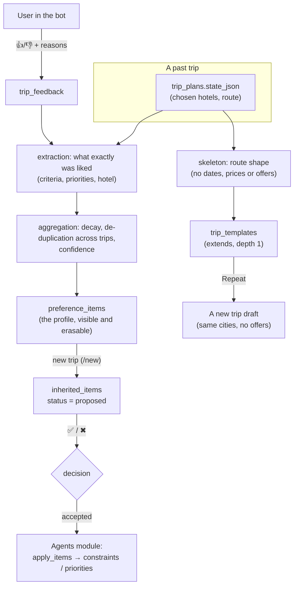

# Trip history, templates and inheritance

The "blend past trips into a new one" screen is described in [trip-blend.md](trip-blend.md).

Module `backend/history`. The idea: the user rates a trip, and when they plan the next one we offer what they liked before. Technically these are templates inside the trip config and the way they merge into a new plan. This document covers the design, the schema, the contract with the agents module, and a deliberately harsh review of the business idea.

## 1. The verdict in one paragraph

The idea is sound, but it should not be framed as "config inheritance". It is **"a transparent, user-controlled memory of tastes, plus repeating a past trip"**. Its value grows over time (it needs two or three trips), so for a hackathon it demonstrates retention and personalisation rather than being the core of the pitch. The main risk is not technical but trust: silent, wrong personalisation is worse than none. That is why nothing in the design is applied without the user's consent, everything is explained ("from your trip to X") and everything can be erased.

## 2. Review of the business idea

### 2.1 What is strong about it

- It hits the track's main pain point: fewer clarifying questions ("breakfast? cancellation? stars?") and a faster first plan.
- It gives a reason to come back to the bot after a trip (to rate it), not only before one.
- The data accumulates on our side: over time this is an advantage a competitor cannot copy overnight.
- Repeating a trip ("the same, but on other dates") is almost free technically and immediately clear to the user.

### 2.2 Risks, most serious first

| # | Risk | Why it is serious | What the design does about it |
|---|---|---|---|
| 1 | **Cold start.** People travel one to three times a year; newcomers have no history at all | The value shows up after months; the jury and new users will not see it | Do not make it the core. The demo has seed data and a flag. A real product needs other sources of taste (see 2.5) |
| 2 | **Few ratings, and biased ones.** A small share of users answer, extreme opinions dominate, "4 stars" says almost nothing | A profile built on noise is worse than an empty one | One-tap rating (👍/😐/👎), optional reasons, and reasons per aspect (price, location, food...). A weak signal has no effect until it repeats in another trip |
| 3 | **Taste depends on context.** A family trip versus a business trip, summer versus winter, different budgets | "Liked a hotel with breakfast" does not mean "always want one" | We suggest, we do not apply. **Party and budget are never inherited.** Hotels only for the same city. Criteria are soft |
| 4 | **Staleness.** Prices, availability and hotel quality change; a hotel may close | An old offer in a new trip is either a bug or a lie | Criteria and priorities are inherited, not offers and prices. A hotel hint stays a hint |
| 5 | **Silent personalisation errors.** The agent applied something old and the user did not notice | It undermines trust in the whole plan | Nothing is applied without ✅. Every item shows its "why". One tap removes it. `/profile` shows everything learned and can "forget everything". A constraint the user named in this trip always beats the past |
| 6 | **Privacy and the law.** Trip history means movements, companions, children's ages | Russia requires consent, a stated purpose and deletion (152-FZ), and care when sending data to an LLM | Everything is erasable (`forget_all`), templates are never shared between users, comment text never reaches the model. **Not done:** explicit consent at onboarding and a legal review |
| 7 | **The "inheritance" metaphor misleads.** Chains and multiple parents make "where did this come from?" unanswerable | Debugging and trust | `extends` depth is exactly 1, a flat snapshot is taken when applying, and editing a template does not change trips already created |
| 8 | **Rating what never happened.** You cannot rate a hotel you have not stayed in | Garbage in the profile | Feedback is accepted only after the trip's end date (the demo has a `HISTORY_ALLOW_EARLY_FEEDBACK` flag) |
| 9 | **Two writers into the plan state** (agents and history) | Races and "last writer wins" | One channel only: accepted `InheritedItem` rows. The agents decide how to apply them; the merge rule in `apply_items` is that whatever the user already set wins |
| 10 | **No way to prove the value** | A feature without metrics is faith | Metrics in 2.4. Every suggestion is stored with its decision, and acceptance is computed from them |

### 2.3 What we deliberately do not do

- We do not copy **party, budget, dates, prices or offers**. Party and budget are the trip's context, not taste: silently copying a family trip into a business trip is the surest way to get a wrong plan.
- We do not share templates between users (a privacy leak, and a separate feature).
- We do not turn a single 👍 into a requirement. One observation is a hint with confidence below the threshold.
- We do not invent tastes from the unknown: "the data has no breakfast" does not mean "the user dislikes breakfast".

### 2.4 How to tell whether it works

- Share of accepted suggestions (`inherited_items.status = accepted` / shown). A low share means we suggest the wrong things.
- Clarifying questions per trip, for users with and without history.
- Time to the first plan.
- Share of repeat trips and share of "Repeat" from history.
- Share of users who answer the rating request (this decides whether there will be enough data at all).
- A/B: half the users get suggestions, the other half do not.

### 2.5 What would be better than surveys, or in addition to them (not implemented)

- **Implicit signals from plan edits**: what the user changed ("make it cheaper"), what they rejected, which alternative they picked. This is stronger and cheaper than a survey, and the agents already have the data (plan versions, `plan_operations`). **Recommended as the next step.**
- A short onboarding ("how do you usually choose a hotel?") against the cold start.
- An automatic rating request a day after check-out, rather than whenever the user remembers.

### 2.6 Verdict

Build it, but in a reduced form and only after the main planning loop is stable. It ranks below plan reliability and honest prices. The contract is designed so that switching it on takes hours: the agents only have to read the accepted suggestions and call `apply_items`.

## 3. What is inherited

| Data class | Inherited? | How |
|---|---|---|
| Criteria (`breakfast`, `free_cancellation`, `min_stars`, `min_rating`, `pets_allowed`, `kid_friendly`; transport: `max_travel_hours`, `max_transfers`, `exclude_modes`, `only_modes`, `avoid_overnight`) | yes | as soft constraints |
| Priorities (`price`, `location`, `rating`, `cancellation`, `meal`, `stars`, `duration`, `transfers`, `schedule`) | yes | weight 0.5-3 |
| A specific hotel (liked / do not suggest) | carefully | a hint (`HotelHint`), only for the same city |
| Route shape (cities, nights in each, how to travel between them) | yes, in a template | "Repeat this trip" |
| Dates, prices, availability, offers | **no** | they go stale the day the trip ends |
| Party, budget | **no** | the trip's context, not taste |

The vocabulary of criteria and priorities **is the agents' own model** (`backend/agents/domain/scoring.py`: `STAY_KINDS`, `TRANSPORT_KINDS`, `PRIORITY_KEYS`). Anything outside it is rejected on input, so garbage never reaches the profile.

## 4. How it fits together

The module depends on `shared`, and on `chat` only for identity (the API session token) and a few helper bot buttons. It talks to the agents through a table, not through imports.

## 5. Schema

| Table | Owner | What it stores |
|---|---|---|
| `trip_feedback` | history | a rating of a trip or of one stay: `sentiment` (-1/0/1), `aspects` (`{"location": 1, "price": -1}`), a comment. One row per (trip, stay), edited in place |
| `preference_items` | history | the profile: items **recomputed from all feedback** (so they never drift from the evidence). `confidence`, `observed_count` (number of distinct trips), `evidence` (the trips behind it), `muted` ("stop suggesting this") |
| `trip_templates` | history | a saved config fragment (`TemplateFragment`), `parent_id` (extends, depth 1), per user only |
| `inherited_items` | **shared** | **the contract with the agents**: a suggestion for a new trip (`chat_id`), `item`, `reason`, `confidence`, `status` = `proposed` / `accepted` / `dismissed`. Unique on (`chat_id`, `item_key`): each item is offered once per trip |

A template fragment (`TemplateFragment`) holds `route` (cities and nights), `legs` (how to travel), `order` (the interleaving, because the real order "flight, transfer, city, train, city, flight" is not a plain alternation), `constraints`, `priorities`, `hotel_hints`, and `remove` (in a child template: what to drop from the parent).

## 6. The contract with the agents

Items are expressed in the agents' own terms, so no translation layer is needed: a constraint item is their `Constraint(kind, value, strength)`, a priority item is their `Priority(key, weight)`.

**What the agents do:**

1. Read the accepted suggestions: `SELECT item, reason, id FROM inherited_items WHERE chat_id = :chat AND status = 'accepted'`, or `HistoryService.accepted(chat_id)`.
2. Apply `shared.templates.apply_items(config, accepted)` to their configuration (`constraints`, `priorities`). The merge rule: **a constraint or priority with the same `kind` / `key` that the trip already has wins**; the past never overrides it.
3. Record provenance: `Source(origin="history", quote=<reason>)`, with `"history"` as a value of `Origin`.
4. Hotel hints arrive in `history_hints` and **are not constraints**: the agents' model has no "preferred hotel" (it has `excluded_offers` on a node and `PinOffer`), so hints are shown in the answer but never enforced.

**Integration notes:**

- `plan_id == chat_id` on the agents' side, and the state lives in `trip_plans.state_json` as a `TripState` with `offers: dict[str, Offer]` (structured `hotel` and `rate`). The module reads both formats (their `TripState` and the flat graph of the demo plans): see `history/facts.py`.
- The database schemas are unified: the agents run on the shared models in `shared/` and on Alembic (migration 0003 added their tables), and the two chat implementations were merged into `backend/chat`.

## 7. The "inheritance" mechanism

The rules are simple on purpose:

- **Depth 1.** A template has at most one parent, and that parent has none. Checked on save.
- **Child over parent** (`resolve`): the route is atomic (the child's route replaces the parent's entirely; lists are not concatenated); criteria and priorities merge by `kind` / `key`, and the child wins; the child's `remove` drops the parent's items. Every item remembers where it came from (`parent` / `child`).
- **A snapshot, not a reference.** An accepted item is copied into `inherited_items`, and a trip draft is built from the already resolved fragment, so editing a template later does not change old trips.
- **A skeleton with nothing extra** (`skeleton_from_state`): cities, nights, travel modes and criteria stay; dates, prices and offers are removed. A test checks that the template JSON has no dates, prices or hotel names.
- **Repeat a trip** (`instantiate`): creates a draft (`status: draft`) with the same cities in the same order and no offers (the map shows "no option chosen"). Given a start date, dates are laid out by nights; without one they stay empty.

## 8. How a rating becomes a suggestion

Extraction rules (`history/extraction.py`), each one guarding against a wrong inference:

- Every item is soft and has confidence below 1: one observation does not make a requirement.
- An unknown fact is not a "no": if the data had no breakfast, "liked the food" does not create a breakfast requirement.
- "Disliked X" becomes the need behind it, never "avoid": a bad price means "price matters more" (`price` weight 2), bad food means "food matters more" (plus "breakfast needed", only if there was none), and never "dislikes breakfast".
- A bare 👍 yields only weak hints (0.3-0.35). They matter only if they repeat.
- Feedback on a whole trip weighs half as much as feedback on a specific stay.

Aggregation (`history/aggregation.py`):

- An observation's weight halves every `HISTORY_HALF_LIFE_DAYS` (365).
- **Several stays of one trip count once** (the strongest is taken): a trip with three hotels is one data point about a person. Independent trips combine as `1 - Π(1 - c)`, capped at 0.95.
- Numeric values (`min_stars` 3/4/5) combine by median, not by the extreme.
- One hotel liked in one trip and disliked in another: the later experience wins.

An item is suggested if its confidence is at least `HISTORY_MIN_CONFIDENCE` (0.4) and it is not muted. At most three at a time, each key once per trip. An item dismissed twice in different trips is muted automatically.

## 9. Privacy and deletion

- `/profile` and `GET /api/v1/history/profile` show **everything** that was learned, with the trips behind it and the confidence.
- Any item can be muted with one button ("stop suggesting this").
- "Forget everything" (`DELETE /api/v1/history/profile`, with a confirmation in the bot) deletes feedback, the profile, templates and suggestions. The trips themselves (chats and plans) stay: other modules own them.
- A comment is stored and shown to the user, but **is never sent to the model**.
- Templates are personal; giving them to other users is not possible.

## 10. API and bot

API (`/api/v1/history`, Mini App session token): `GET /trips`, `POST /trips/{chat}/feedback`, `GET /profile`, `POST /profile/items/{id}/mute|unmute`, `DELETE /profile`, `POST|GET /chats/{chat}/suggestions`, `POST /suggestions/{id}/accept|dismiss`, `POST|GET /templates`, `GET /templates/{id}` (after `extends`), `POST /templates/{id}/start`, `GET /trips/{chat}/essence` and `POST /chats/{chat}/blend` (the blend screen). Someone else's data returns 404; rating a trip before it ends returns 409.

Bot: `/history` (cards of past trips: ⭐ Rate, 🔁 Repeat), rating a stay with buttons (👍😐👎, then reasons as toggles), `/profile` (what was learned, 🚫 remove, 🗑 forget everything), suggestions on `/new` (✅ / ✖ for each).

## 11. Implementation status

**Done and covered by tests** (the defences were checked by mutation: the tests fail if you break de-duplication across trips, the no-rating-before-the-trip rule, the same-city filter for hotels, the user's priority, or the meaning of "bad food"):

- the contract in `shared/templates.py` (vocabulary, items, `apply_items`), the `inherited_items` table, the `suggestions.proposed` event;
- extraction, aggregation, skeleton and `extends`, the service, the API, the bot, the "new trip" hook, migration `0002`;
- the agents read accepted items and apply them with `origin="history"` (`agents/runtime/deltas.py`, `inherited_ops`);
- repeating a trip creates a draft that the map shows with grey pins;
- the blend screen ([trip-blend.md](trip-blend.md)).

**Not done:**

- Implicit signals from plan edits (recommended first).
- An automatic rating request a day after check-out; consent to data processing; a legal review.
- Context tags (party, season, purpose of the trip): taste is currently treated as general, softened only by the threshold and the manual confirmation.
- Renaming and deleting templates (saving, listing and starting exist).

## 12. A demo script

1. `/demo japan` (a mock trip), with `HISTORY_ALLOW_EARLY_FEEDBACK=true` (the demo trips are in the future).
2. `/history`, ⭐ Rate, 👍 for the hotel in Osaka, tick "Food" and "Location".
3. `/profile`: "Breakfast included" is listed, with "Tokyo and Osaka" as its evidence.
4. `/new`: the bot suggests "Breakfast included" and "Good location"; the user taps ✅ / ✖.
5. `/history`, 🔁 Repeat: a new draft with the same cities, grey pins on the map and no prices.
